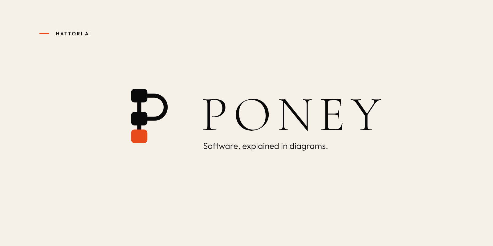

# Poney for Elixir



<p>
  <a href="https://hex.pm/packages/poney">
    
  </a>
  <a href="https://hexdocs.pm/poney">
    
  </a>
  <a href="https://github.com/hattoriai/poney-elixir/actions">
    
  </a>
</p>

**Read, check and write Poney documents in Elixir.**

[Poney](https://github.com/hattoriai/poney) is an open format for
explaining software with diagrams. A coding agent reads a repository and
writes a `.poney` file: a model of the system, its views, and walkthroughs
that explain one change, or tour the code as it is. This library reads those
files as the specification says, so your Elixir app can check them, show
their story, and write them back.

It draws nothing. Poney's JavaScript packages draw the diagrams; the
`<poney-diagram>` element shows one in any page, LiveView included.

> Early release. Before 1.0, a minor version may change the API.

## Install

You need Elixir 1.18+. The library has no run-time dependencies.

```elixir
{:poney, "~> 0.1"}
```

## Read a document

```elixir
{:ok, doc} = Poney.read(File.read!("change.poney"))

doc.project.name
#=> "Kestrel Commerce"
```

`Poney.read/1` takes JSON text or decoded JSON. It returns the document in
its canonical form, as structs: every default is filled in, and a view
written inside a walkthrough scene is in `doc.views`, so a scene's `view`
is always the id of one.

When a document is not valid, you get every problem, with where it is and
how to fix it:

```elixir
{:error, issues} = Poney.read(json)

for issue <- issues, do: IO.puts(issue)
#=> model.relationships.4.target: Unknown entity "paymnets"
```

```elixir
[%Poney.Issue{path: "model.relationships.4.target", hint: ~s(Did you mean "payments"?)}] = issues
```

`Poney.check/1` lists warnings too, such as an entity kind with no style.

## Walk a walkthrough

```elixir
for walkthrough <- doc.walkthroughs do
  IO.puts(walkthrough.title)
  IO.puts(walkthrough.story.text)

  for scene <- walkthrough.scenes do
    IO.puts("#{scene.title}: #{scene.text}")

    for callout <- scene.callouts, do: IO.puts("  #{callout.target}: #{callout.text}")
  end
end
```

A walkthrough names elements by refs such as `"entity:order-service"`;
`Poney.Ref` reads and writes them. [Walkthroughs](guides/walkthroughs.md)
shows the parts of a scene and how to show them in a page.

## Write a document

```elixir
{:ok, text} = Poney.write(%{doc | project: %{doc.project | name: "Kestrel"}})
File.write!("change.poney", text)
```

`Poney.write/1` checks the document first: it writes only what a reader
accepts. The text is indented JSON with members in the format's order, so it
diffs well. Reading a file and writing it keeps everything in it, the data of
extensions this library does not know too.

## What "as the specification says" means

Reading a document takes the specification's steps, in order:

1. A document for format 0.1.0 is upgraded to the current version.
2. Its shape must match the format's published JSON Schema. A member the
   format does not know is an error.
3. Code in a scene is a diff or an excerpt, not both.
4. The canonical form: defaults filled in, inline views moved into `views`,
   excerpts turned into hunks of unchanged lines.
5. The rules JSON Schema cannot say: unique ids, references that exist,
   well-formed behaviors and walkthroughs, declared extensions.

The library reads the schema file itself (`priv/spec/poney.schema.json`),
copied from a tagged release of Poney, and runs the specification's
conformance suite in its tests. [Conformance](guides/conformance.md) says how
the copy is kept up to date.

## Limits

- **Extensions.** This library knows no extension yet. A document that
  requires one is refused; an optional one is kept, unchecked, with a warning.
- **Lints.** It does not report the format's lints (§9.3), such as a scene
  that shows too much. Poney's CLI does.
- **Drawing.** None: use Poney's JavaScript packages.

## License

MIT. See [LICENSE](https://github.com/hattoriai/poney-elixir/blob/main/LICENSE).
